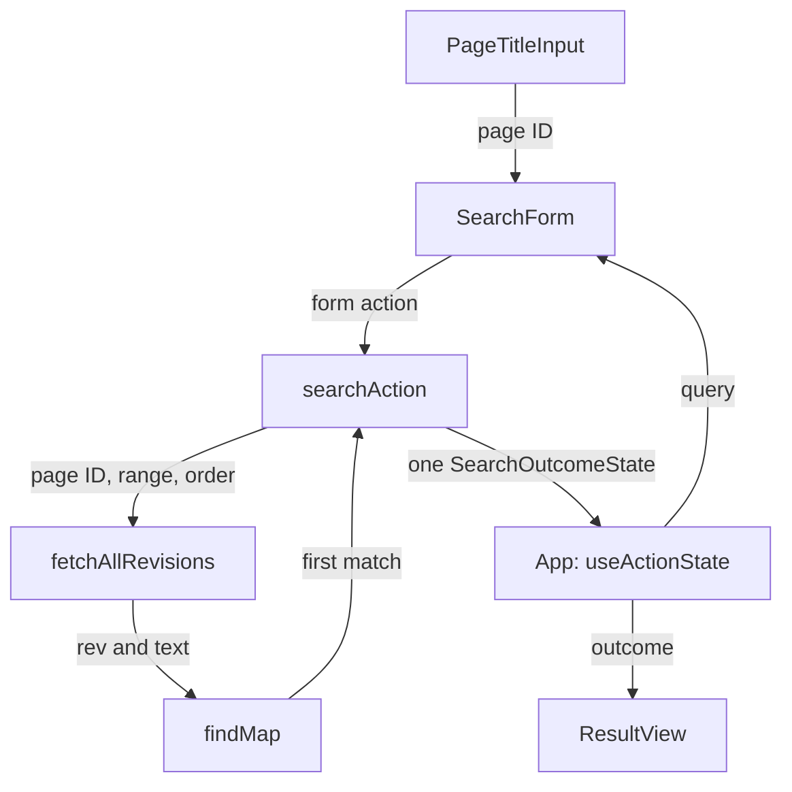

# Wikipedia Blame: Architecture Overview

How one search travels from the form to a revision ID. This document owns the system's boundaries and invariants; decisions live in `docs/adr/`, cross-module contracts in `docs/implementation-notes.md`, and local mechanics next to the code they describe.

## Flow

1. `PageTitleInput` resolves the article title to a page ID before the form is submitted.
2. Submitting the form runs `searchAction` with the resolved page ID and the query.
3. The action streams revisions through `fetchAllRevisions` and asks `findMap` for the first revision whose text contains the target.
4. The action returns a single `SearchOutcomeState`; `useActionState` stores it in the `SearchState` union and re-renders the form and `ResultView` from it.

## Components

- `App` owns `useActionState` and the `QueryClient`, and forwards the search state.
- `SearchForm` composes the wiki selector, the title input, the text field and the optional range and order controls into one form.
- `PageTitleInput` resolves the title to a page ID.
- `ResultView` renders the outcome of the last search.

## State

`SearchState` is `QueryState` (what the user asked for), `OutcomeState` (what the search produced, keyed by `status`) and the resolved `pageId`. `InitialState` is the `useActionState` initial value; `searchAction` returns `SearchOutcomeState`, which excludes it. `isPending` owns the running state. `App` forwards that one state; each component's props narrow it to the slice it needs, so the form cannot read the outcome and the view cannot read `pageId`.

## Page ID lookup (`PageTitleInput`)

Resolves the title with `useQuery`; the debounce, messages and retry UI stay local to the component (ADR-004, ADR-005).

## Search action (`searchAction`)

Validates the form, builds the revision options and returns one `SearchOutcomeState` assembled from the submitted query. Validation failures and search errors share the `error` outcome; a complete search with no match is `not-found`; `initial` is never returned.

## Revision stream (`fetchAllRevisions`)

An async generator that pages through the Action API and yields `{ rev, text }` items. The request and parser contracts are in `docs/implementation-notes.md`; the action stops at the first match (ADR-001).

## Rendering (`ResultView`)

`isPending` wins first; otherwise the view switches on `status` and renders `initial` as nothing, `error`, `not-found` or `found` inside a status region that stays mounted from the first render, so screen readers announce each result. The not-found copy belongs to the view.

## Invariants

- The hidden `pageId` input is rendered unconditionally, including while loading and on error, so a form can never submit an ID that belongs to another title (ADR-005).
- The search is linear and exits at the first match; sampling was removed on purpose (ADR-001).
- Revisions stream through a JSON parser, so a long history is never held in memory at once.
- Page IDs never change, so TanStack Query keeps them for one hour (ADR-004).
- `maxage` is 60s only for the first, newest batch of revisions and 600s otherwise, so recent edits stay visible (ADR-002).
- Downloading `pages-meta-history` dumps was rejected as too slow for an interactive search (ADR-003).

## Further reading

- `docs/implementation-notes.md` — cross-module implementation contracts.
- `docs/adr/` — architecture decision records.
- `docs/testing.md` — test conventions.
- `docs/functional-style.md` — code style.
