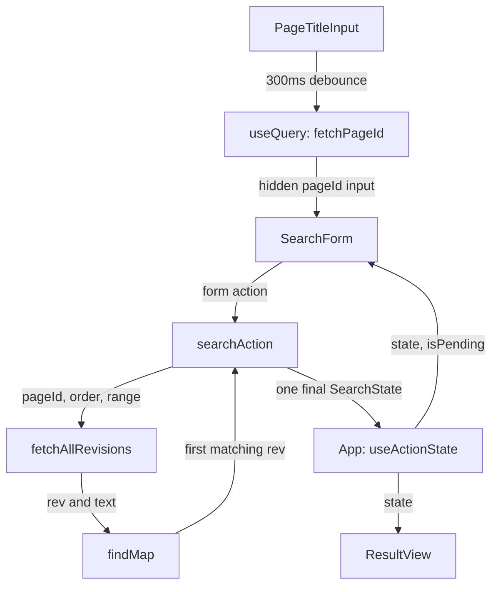

# Wikipedia Blame: Architecture Overview

How one search travels from the form to a revision ID. Decisions and their
rationale live in `docs/adr/`.

## Flow

1. `PageTitleInput` resolves the article title to a page ID before the form is
   submitted.
2. Submitting the form runs `searchAction` with the page ID, the target text
   and the optional range.
3. The action streams revisions through `fetchAllRevisions` and asks `findMap`
   for the first revision whose text contains the target.
4. The action returns a single `SearchState`; `useActionState` re-renders the
   form and `ResultView` from it.

## Components

- `App` owns `useActionState` and provides the `QueryClient`.
- `SearchForm` holds the selected wiki and composes the title input, the text
  field and the optional range and order controls.
- `PageTitleInput` resolves the title to a page ID with `useQuery`.
- `ResultView` renders the pending, error, not-found and success states inside a
  persistent status region.

## Page ID lookup (`PageTitleInput`)

- The title is trimmed and debounced by 300ms with `useDebouncedValue`.
- `useQuery` is keyed by `['pageId', wikiUrl.href, debouncedTitle]` and calls
  `fetchPageId` (REST API, `/w/rest.php/v1/page/{title}/bare`).
- A 404 is not retried: `isNotFoundError` reads the response attached as the
  error cause. Other failures retry once.
- The resolved ID is submitted through a hidden `pageId` input that is rendered
  unconditionally, including while loading and on error, so the form can never
  submit an ID that belongs to a different title (ADR-005).
- "Checking title...", "Page not found." and the retry button are local to this
  component; `searchAction` only reads the ID from the form.

## Search action (`src/actions/search.ts`)

- Validates the wiki URL, the page ID, the title and the target text. Every
  failure returns the previous state plus an error and bumps `searchCount`.
- Builds the options object from the form: `order` (`asc` by default, which
  means older first), `startRevId` and `endRevId`, each optional.
- Hands the generator to `findMap` with a mapper that tests
  `item.text.includes(targetText)` and returns `item.rev`.
- Returns one `SearchState`. The search is linear and stops at the first match;
  sampling was removed on purpose (ADR-001).

## Revision stream (`fetchAllRevisions`)

- Calls the Action API (`prop=revisions`, `rvprop=ids|content`,
  `rvslots=main`, `rvlimit=max`) and follows `rvcontinue` in a loop.
- Pipes each response body through `@streamparser/json-whatwg` with paths for
  `batchcomplete`, `continue.rvcontinue` and the slot content. Every content
  match is yielded as `{ rev, text }`, so a long history is never held in
  memory at once.
- `maxage` is 600s for the first page in ascending order and for every
  continuation page, and 60s only for the first page in descending order, so
  recent edits stay visible (ADR-002).
- Downloading `pages-meta-history` dumps was rejected because the download
  alone is too slow for an interactive search (ADR-003).
- A failed request is logged inside the generator and ends the stream, which
  the action then reports as "text not found".

## Rendering (`ResultView`)

- The container is a `role="status"` region that stays mounted, so the result
  card is announced when it changes.
- A missing revision renders the not-found message. A found revision links to
  `oldid=<rev>&diff=prev` when ascending and `diff=next` when descending.

## Caching

- TanStack Query keeps page IDs for one hour (`staleTime` in `src/App.tsx`)
  because page IDs never change (ADR-004).
- Revision responses are not cached by TanStack Query; the browser may reuse
  them within the `maxage` window described above.

## Further reading

- `docs/adr/` — architecture decision records.
- `docs/testing.md` — test conventions.
- `docs/functional-style.md` — code style.
